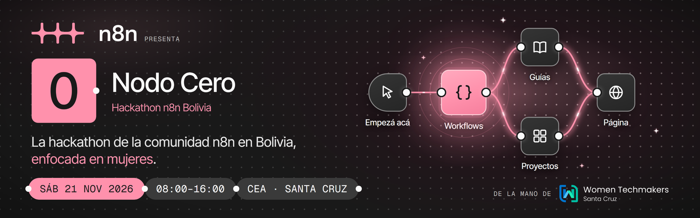
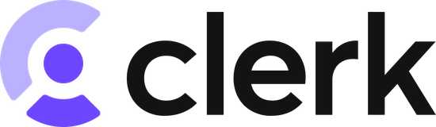
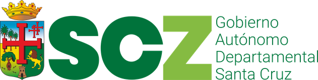

  

<h3 align="center">La hackathon de la comunidad n8n en Bolivia, enfocada en mujeres, de la mano de Women Techmakers Santa Cruz.</h3>

  Sábado 21 de noviembre de 2026 · 08:00 a 16:00 · Centro de Educación Ambiental (CEA), Santa Cruz de la Sierra

  <a href="https://nodo-cero-bo.github.io"><b>Página del evento</b></a> ·
  <a href="https://github.com/nodo-cero-bo/workflows">Workflows</a> ·
  <a href="https://github.com/nodo-cero-bo/guias">Guías</a> ·
  <a href="https://github.com/nodo-cero-bo/proyectos/issues/new?template=proyecto.yml">Registrá tu proyecto</a>

 

**Nodo Cero** es un día para construir automatizaciones y agentes de IA con n8n, en equipos de hasta cuatro personas, y dejarlos funcionando. Acá está todo lo que necesitás para arrancar hoy y seguir construyendo después: workflows listos para importar, guías paso a paso y la vitrina de los proyectos del día.

## Empezá acá

1. **Creá tus cuentas.** Tu cuenta de [n8n Cloud](https://app.n8n.cloud/register) y, según tu idea, Supabase, Clerk, Core Wallet o Google Cloud. Las [guías](https://github.com/nodo-cero-bo/guias) te llevan paso a paso.
2. **Importá un workflow.** Elegí uno en el [catálogo de la página](https://nodo-cero-bo.github.io), tocá «Copiar workflow» y pegalo en el canvas de n8n con Ctrl + V.
3. **Conectá tus credenciales y probalo.** Cada workflow trae notas adentro que explican qué hace cada paso, por qué y qué credencial pide.

- **¿Primera vez con n8n?** Seguí el [tutorial paso a paso](https://github.com/nodo-cero-bo/guias/tree/main/tutorial): te dice qué vas a ver en pantalla en cada paso, y no se rompe nada si probás.
- **¿Una palabra no te suena?** Está explicada en el [glosario](https://github.com/nodo-cero-bo/guias/blob/main/glosario.md).
- **¿Vas a usar Google Cloud?** La [guía de Google Cloud y créditos](https://github.com/nodo-cero-bo/guias/blob/main/00-empezar/08-google-cloud.md) explica cómo canjear los créditos si tu equipo los recibió o usar el nivel gratuito, cómo poner alertas de presupuesto y cómo apagar todo al terminar. Ojo: desde el 16 de noviembre de 2026, el crédito de bienvenida de la prueba gratis no paga Vertex AI ni la API de Gemini; para IA gratis, usá Gemini con la [clave de Google AI Studio](https://github.com/nodo-cero-bo/guias/blob/main/00-empezar/07-clave-gemini.md).

Cuando tu equipo tenga el proyecto andando, [registralo en la vitrina](https://github.com/nodo-cero-bo/proyectos/issues/new?template=proyecto.yml).

## Las 4 líneas de la hackathon

Cada equipo elige una línea. Tocá cada una para ver su guía.

| Línea | De qué se trata |
|---|---|
| [**IA para tu comunidad**](https://github.com/nodo-cero-bo/guias/blob/main/lineas/ia.md) | Agentes y asistentes con Gemini y búsqueda en tus documentos con Supabase. |
| [**Web3 con Avalanche Fuji**](https://github.com/nodo-cero-bo/guias/blob/main/lineas/web3.md) | Leer la red, verificar pagos, contratos y eventos. Con Team1. |
| [**Apps con login y datos**](https://github.com/nodo-cero-bo/guias/blob/main/lineas/apps.md) | Clerk, Supabase y n8n como backend. |
| [**Impacto social y ambiental**](https://github.com/nodo-cero-bo/guias/blob/main/lineas/impacto.md) | Problemas reales de Santa Cruz y de Bolivia. |

**Ganadores y menciones.** Hay 3 equipos ganadores (1.er, 2.º y 3.er lugar) y 2 menciones especiales: **Mejor uso de Avalanche Fuji** y **Mejor uso de Google Cloud**. Cualquier línea puede quedar entre los 3 lugares y postularse a las 2 menciones, desde el formulario de la vitrina.

## Los repos

| Repo | Para qué sirve |
|---|---|
| [**workflows**](https://github.com/nodo-cero-bo/workflows) | Los workflows de n8n del evento, listos para importar: fundamentos, IA, Avalanche Fuji, Clerk, Supabase, proyectos completos, Google Cloud y casos de uso. Cada uno con notas que enseñan, su README y un auditor que corre en cada cambio. |
| [**guias**](https://github.com/nodo-cero-bo/guias) | El tutorial, el glosario, las líneas de la hackathon, crear cuentas, importar workflows, conectar credenciales, ideas de proyecto, cómo presentar y cómo seguir construyendo. |
| [**proyectos**](https://github.com/nodo-cero-bo/proyectos) | La vitrina: cada equipo registra su proyecto con un formulario y la lista se arma sola. |
| [**nodo-cero-bo.github.io**](https://github.com/nodo-cero-bo/nodo-cero-bo.github.io) | El código de la [página del evento](https://nodo-cero-bo.github.io): catálogo con filtros y botón «Copiar workflow», guías, Avalanche Fuji a mano, agenda, mentoría y aliados. |

## Agenda del día

| Hora | Qué pasa |
|---|---|
| 08:00 | Acreditación y café |
| 12:00 | Almuerzo |
| 14:30 | Refrigerio |
| 15:00 | Presentaciones |
| 15:45 | Cierre, menciones y foto grupal |
| 16:00 | Fin |

## Avalanche Fuji, a mano

Es la línea [Web3 con Avalanche Fuji](https://github.com/nodo-cero-bo/guias/blob/main/lineas/web3.md), con Team1, y la mención especial **Mejor uso de Avalanche Fuji**, para el equipo que mejor integre Fuji en su proyecto.

- [**Descargá Core Wallet**](https://core.app/?utm_source=nodo-cero&utm_medium=github&utm_campaign=hackathon-n8n-bolivia-2026) y activá el modo testnet para pasar a Fuji.
- [**Pedí AVAX de prueba en el faucet**](https://build.avax.network/console/primary-network/faucet).
- [**Aprendé en Avalanche Academy**](https://build.avax.network/academy?utm_source=nodo-cero&utm_medium=github&utm_campaign=hackathon-n8n-bolivia-2026): cursos guiados. Si recién empezás, arrancá por Blockchain Fundamentals y seguí con Avalanche Fundamentals, que da certificado.
- [**Sumate a Team1**](https://www.team1.network/?utm_source=nodo-cero&utm_medium=github&utm_campaign=hackathon-n8n-bolivia-2026), el programa de comunidad de Avalanche.
- [**Explorá tus transacciones**](https://build.avax.network/explorer/fuji/c-chain) en el explorador de Fuji.

Red: Avalanche Fuji C-Chain · chainId `43113` (`0xa869`) · RPC público `https://api.avax-test.network/ext/bc/C/rpc`

## Con quiénes lo hacemos

PRESENTA  
  <a href="https://n8n.io"><picture><source media="(prefers-color-scheme: dark)" srcset="https://raw.githubusercontent.com/nodo-cero-bo/.github/main/profile/assets/n8n-oscuro.png"></picture></a>

CON EL APOYO DE  
  <a href="https://supabase.com"><picture><source media="(prefers-color-scheme: dark)" srcset="https://raw.githubusercontent.com/nodo-cero-bo/.github/main/profile/assets/supabase-oscuro.png"></picture></a>
  &nbsp;&nbsp;&nbsp;&nbsp;&nbsp;&nbsp;
  <a href="https://clerk.com"><picture><source media="(prefers-color-scheme: dark)" srcset="https://raw.githubusercontent.com/nodo-cero-bo/.github/main/profile/assets/clerk-oscuro.png"></picture></a>
  &nbsp;&nbsp;&nbsp;&nbsp;&nbsp;&nbsp;
  <a href="https://www.team1.network/?utm_source=nodo-cero&utm_medium=github&utm_campaign=hackathon-n8n-bolivia-2026"><picture><source media="(prefers-color-scheme: dark)" srcset="https://raw.githubusercontent.com/nodo-cero-bo/.github/main/profile/assets/team1-oscuro.png"></picture></a>
  &nbsp;&nbsp;&nbsp;&nbsp;&nbsp;&nbsp;
  <a href="https://www.aspireleaders.org"><picture><source media="(prefers-color-scheme: dark)" srcset="https://raw.githubusercontent.com/nodo-cero-bo/.github/main/profile/assets/aspire-oscuro.png"></picture></a>

EN COLABORACIÓN CON  
  <a href="https://www.instagram.com/wtmsantacruz/"><picture><source media="(prefers-color-scheme: dark)" srcset="https://raw.githubusercontent.com/nodo-cero-bo/.github/main/profile/assets/wtm-oscuro.png"></picture></a>

SEDE  
  <a href="https://www.santacruz.gob.bo"><picture><source media="(prefers-color-scheme: dark)" srcset="https://raw.githubusercontent.com/nodo-cero-bo/.github/main/profile/assets/gobierno-oscuro.png"></picture></a>

## Enlaces útiles

- [Inscripción en Luma](https://luma.com/n8n-rfgv) (con aprobación)
- [Documentación de n8n](https://docs.n8n.io) y [cómo importar y exportar workflows](https://docs.n8n.io/build/manage-workflows/export-and-import)
- [Foro de la comunidad n8n](https://community.n8n.io)
- [Women Techmakers Santa Cruz en Instagram](https://www.instagram.com/wtmsantacruz/)

 

Workflows y código bajo licencia MIT; guías bajo CC BY 4.0. n8n, Supabase, Clerk, Avalanche, Team1, Aspire Institute, Women Techmakers y el Gobierno Autónomo Departamental de Santa Cruz son marcas de sus dueños: sus logos se usan tal cual para nombrar a quienes hacen posible el evento (el de Aspire Institute, que no tiene versión para fondo oscuro, va sobre una placa clara en el tema oscuro) y no entran en ninguna licencia.
